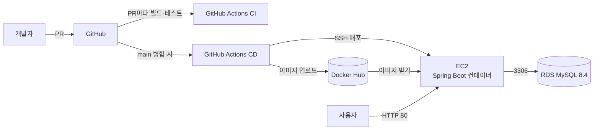

# SPO:IT

서울 열린데이터광장 공공데이터를 활용한 **공공 체육시설 예약 및 소셜 매칭 플랫폼**입니다.
지역·종목·시간대로 체육시설과 매칭을 찾고, 개인 또는 동호회 단위로 참가 신청하며, 경기 후 평가로 종목별 실력(MMR)을 관리합니다.

- **배포 주소**: http://13.124.122.90
  - EC2를 재시작하면 주소가 바뀔 수 있습니다. 바뀌면 이 README와 GitHub Secret `EC2_HOST`를 함께 수정합니다.

## 주요 기능

| 구분                | 기능                                                                    |
| ------------------- | ----------------------------------------------------------------------- |
| 회원 (COM)          | 회원가입, 로그인, 개인정보·선호 지역 관리, 알림                         |
| 예약자 (RES)        | 시설·매칭 검색, 개인/동호회 참가 신청·취소, 예약 내역, 동호회 생성·관리 |
| 매칭·레이팅 (MAT)   | 참가자 관리, A/B팀 배정, 경기 결과 제출, 팀장 기술평가, 종목별 MMR      |
| 시설 관리자 (FAC)   | 담당 시설·운영 시간·예외 일정 관리, 예약 현황·통계                      |
| 시스템 관리자 (ADM) | 사용자, 신고, 페널티 관리                                               |

## 기술 스택

| 영역     | 사용 기술                                            |
| -------- | ---------------------------------------------------- |
| Language | Java 17                                              |
| Backend  | Spring Boot 3.5.16, Spring Security, MyBatis 3.0.5   |
| Frontend | Thymeleaf                                            |
| Database | MySQL 8.4 (운영, Amazon RDS) / MySQL 8.0 이상 (로컬) |
| Build    | Gradle                                               |
| CI/CD    | GitHub Actions                                       |
| Infra    | Docker, Docker Hub, AWS EC2, Amazon RDS (서울 리전)  |

## 아키텍처



## 로컬 실행 방법

### 1. 준비물

- JDK 17
- MySQL 8.0 이상 (8.0.16 이상이어야 스키마의 CHECK 제약이 동작합니다)
- Git

### 2. 저장소 받기

```bash
git clone https://github.com/spoit-team/spoit.git
cd spoit
git checkout develop
```

### 3. 데이터베이스 생성

MySQL에 접속해 DB를 만들고, `db/schema.sql`을 실행합니다.

```sql
CREATE DATABASE spoit DEFAULT CHARACTER SET utf8mb4 COLLATE utf8mb4_0900_ai_ci;
```

DBeaver를 쓴다면 `spoit` 스키마를 선택한 뒤 `db/schema.sql`을 열어 **Alt+X**로 전체 실행합니다.
DBeaver 연결 설정의 Driver properties에 `allowPublicKeyRetrieval=true`, `characterEncoding=UTF-8`을 넣어 주세요.

### 4. 로컬 설정 파일 만들기

`src/main/resources/application-local.properties.example`을 복사해 같은 폴더에 `application-local.properties`로 저장하고, 본인 DB 정보로 수정합니다.

```properties
spring.datasource.url=jdbc:mysql://localhost:3306/spoit?serverTimezone=Asia/Seoul&characterEncoding=UTF-8&allowPublicKeyRetrieval=true&useSSL=false
spring.datasource.driver-class-name=com.mysql.cj.jdbc.Driver
spring.datasource.username=root
spring.datasource.password=본인_비밀번호
```

이 파일은 `.gitignore`에 등록되어 있어 Git에 올라가지 않습니다. **비밀번호는 절대 커밋하지 마세요.**

### 5. 실행

```bash
# Windows
gradlew.bat bootRun

# macOS / Linux
./gradlew bootRun
```

http://localhost:8080 으로 접속합니다.

## 브랜치와 배포 흐름

```
feature/* ──PR(승인 1명 + build 통과)──▶ develop ──PR(팀장)──▶ main ──자동──▶ 배포
```

| 브랜치         | 용도                    | 병합                                               |
| -------------- | ----------------------- | -------------------------------------------------- |
| `main`         | 운영 배포               | 팀장만, **Create a merge commit**                  |
| `develop`      | 개발 통합 (기본 브랜치) | 팀원 승인 1명 + `build` 통과, **Squash and merge** |
| `feature/*` 등 | 개인 작업               | 최신 develop에서 생성                              |

- **CI** (`.github/workflows/ci.yml`): develop·main으로 가는 PR마다 테스트용 MySQL을 띄워 빌드와 테스트를 실행합니다. 실패하면 병합할 수 없습니다.
- **CD** (`.github/workflows/deploy.yml`): main에 병합되면 Docker 이미지를 빌드해 Docker Hub에 올리고, EC2에서 새 컨테이너로 교체합니다. Actions 탭에서 진행 상황을 볼 수 있습니다.

브랜치 이름, 커밋 메시지 규칙은 [CONTRIBUTING.md](CONTRIBUTING.md)를 참고하세요.

## 폴더 구조

```
spoit/
├── .github/
│   ├── workflows/
│   │   ├── ci.yml              # PR 빌드·테스트
│   │   └── deploy.yml          # main 병합 시 배포
│   └── pull_request_template.md
├── db/
│   ├── schema.sql              # 전체 테이블 DDL (MySQL 8)
│   └── erd.mermaid             # ERD
├── src/                        # Spring Boot 핵심 소스와 공통 템플릿·정적 리소스
├── preview/                    # 선택 사항: 프리뷰 전용 컨트롤러·fixture·모델·테스트 (기본 빌드 제외)
├── Dockerfile
├── CONTRIBUTING.md             # 팀 작업 규칙
├── PREVIEW.md                  # 프리뷰 UI 활성화/비활성화 방법
└── build.gradle
```

기본 빌드는 `preview/`를 포함하지 않으며, 메인 코어 페이지 컨트롤러가 기존 화면을 빈 데이터로 렌더링해
모든 페이지 URL이 HTTP 200으로 열립니다. 프리뷰 fixture가 필요할 때만 `-Ppreview=true`로
명시적으로 활성화하며, 이때는 코어 페이지 컨트롤러와 코어 라우트 테스트가 빌드에서 제외됩니다.
`preview/` 폴더를 삭제해도 동일하게 동작합니다.
자세한 내용은 [PREVIEW.md](PREVIEW.md)를 참고하세요.

## DB 스키마 변경 규칙

테이블이나 컬럼을 바꿀 때는 `db/schema.sql`과 `db/erd.mermaid`를 **같은 PR에서 함께** 수정하고, PR 설명에 변경 내용과 이유를 적습니다.
운영 RDS 반영은 팀장이 별도로 진행합니다.

## 팀원

| 이름   | GitHub                                           | 담당                        |
| ------ | ------------------------------------------------ | --------------------------- |
| 김혜율 | [@HyeyulKim](https://github.com/HyeyulKim)       | 팀장, 예약(RES-01~06), 배포 |
| 권남진 | [@skawls622](https://github.com/skawls622)       |                             |
| 박기환 | [@kihuanf-cmyk](https://github.com/kihuanf-cmyk) |                             |
| 박용민 | [@yongminp42](https://github.com/yongminp42)     |                             |
