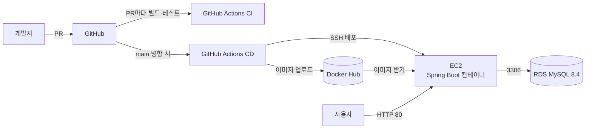

# SPO:IT

서울 열린데이터광장 공공데이터를 활용한 **공공 체육시설 예약 및 소셜 매칭 플랫폼**입니다.
지역·종목·시간대로 체육시설과 매칭을 찾고, 개인 또는 동호회 단위로 참가 신청하며, 경기 후 평가로 종목별 실력(MMR)을 관리합니다.

- **배포 주소**: http://13.124.122.90
  - EC2를 재시작하면 주소가 바뀔 수 있습니다. 바뀌면 이 README와 GitHub Secret `EC2_HOST`를 함께 수정합니다.

## 주요 기능

| 구분                | 기능                                                                    |
| ------------------- | ----------------------------------------------------------------------- |
| 회원 (COM)          | 회원가입, 로그인, 개인정보·선호 지역 관리, 알림                         |
| 예약자 (RES)        | 시설·매칭 검색, 개인/동호회 참가 신청·취소, 예약 내역, 동호회 생성·관리 |
| 매칭·레이팅 (MAT)   | 참가자 관리, A/B팀 배정, 경기 결과 제출, 팀장 기술평가, 종목별 MMR      |
| 시설 관리자 (FAC)   | 담당 시설·운영 시간·예외 일정 관리, 예약 현황·통계                      |
| 시스템 관리자 (ADM) | 사용자, 신고, 페널티 관리                                               |

## 기술 스택

| 영역     | 사용 기술                                            |
| -------- | ---------------------------------------------------- |
| Language | Java 17                                              |
| Backend  | Spring Boot 3.5.16, Spring Security, MyBatis 3.0.5   |
| Frontend | Thymeleaf                                            |
| Database | MySQL 8.4 (운영, Amazon RDS) / MySQL 8.0.16 이상 (로컬) |
| Build    | Gradle                                               |
| CI/CD    | GitHub Actions                                       |
| Infra    | Docker, Docker Hub, AWS EC2, Amazon RDS (서울 리전)  |

## 아키텍처



## 로컬 실행 방법

### 1. 준비물

- JDK 17
- MySQL 8.0.16 이상 (MySQL 8.4 권장)
- Git

스키마가 `utf8mb4_0900_ai_ci`를 사용하므로 MariaDB는 호환 DB로 간주하지 않습니다.

### 2. 저장소 받기

```bash
git clone https://github.com/spoit-team/spoit.git
cd spoit
git checkout develop
```

### 3. 개발용 데이터베이스 준비

본인이 소유한 **새 개발용 DB**에 적용합니다. `schema.sql`은 기존 테이블을 삭제한 뒤 다시 만들기 때문에 기존 데이터가 있는 DB에는 실행하지 마세요. 로컬 MySQL 관리 도구에서 관리 권한으로 아래 DB를 생성하고, 전용 개발 계정에 해당 DB의 스키마·데이터 작업 권한을 부여합니다. 이후 애플리케이션과 일반 접속에는 `root` 대신 전용 계정을 사용합니다.

```sql
CREATE DATABASE spoit DEFAULT CHARACTER SET utf8mb4 COLLATE utf8mb4_0900_ai_ci;
```

저장소 루트에서 MySQL client를 실행합니다. 비밀번호는 `-p` 프롬프트에 입력하며 명령에 직접 쓰지 않습니다.

```text
mysql --default-character-set=utf8mb4 -u 개발용계정 -p
```

클라이언트에서 스키마를 선택하고 두 SQL 파일을 순서대로 실행합니다. `SOURCE` 경로는 저장소 루트에서 실행할 때 기준입니다. 오류가 나면 중단하고 원인을 확인하세요. `--force`로 오류를 무시하지 마세요.

```sql
USE spoit;
SOURCE db/schema.sql;
SOURCE db/seed.sql;
```

`seed.sql`은 빈 DB에 한 번만 넣는 개발용 더미 데이터입니다. 이미 가져온 DB에는 다시 실행하지 마세요. 재구성이 필요하면 먼저 데이터를 백업하고, 별도의 새 개발 DB를 만들어 스키마와 seed를 처음부터 적용하세요. [시드 계정 및 주의사항](db/seed-accounts.md)도 확인하세요.

### 4. 로컬 설정 파일 만들기

기본 `application.properties`는 `DB_USERNAME`과 `DB_PASSWORD` 환경 변수를 사용하므로, OS 또는 IDE의 실행 설정에 두 값을 비밀값으로 설정하면 별도 로컬 설정 파일 없이 실행할 수 있습니다. 기본 datasource URL은 `localhost:3306/spoit`입니다. 다른 호스트나 포트를 쓰면 `SPRING_DATASOURCE_URL`도 같은 방식으로 설정하세요.

선택적으로 `src/main/resources/application-local.properties.example`을 같은 폴더의 무시 대상 파일 `application-local.properties`로 복사해 사용할 수도 있습니다. 예시의 환경 변수 참조를 유지하려면 OS/IDE에서 `DB_USERNAME`, `DB_PASSWORD`를 설정하고, 로컬 파일에 직접 입력하려면 복사본에서 username/password 값을 본인 개발 계정 값으로 바꾸세요. 실제 값이 든 로컬 파일은 공유하거나 커밋하지 않습니다.

로컬 파일은 자동으로 활성화되지 않습니다. 이 파일을 선택한 경우에만 아래처럼 `local` 프로필을 명시해 실행합니다.

### 5. 실행

```bash
# Windows PowerShell / 명령 프롬프트
.\gradlew.bat bootRun --args="--spring.profiles.active=local"

# macOS / Linux
./gradlew bootRun --args='--spring.profiles.active=local'
```

로컬 파일을 사용하지 않고 OS/IDE 환경 변수만 설정한 경우에는 `gradlew.bat bootRun` 또는 `./gradlew bootRun`으로 실행합니다. IDE에서도 같은 방식으로 환경 변수와 필요 시 `--spring.profiles.active=local` 인자를 지정하세요.

http://localhost:8080 으로 접속합니다.

현재 실제 DB 조회가 연결된 업무 화면은 매칭 목록입니다. 매칭 상세·신청과 그 밖의 업무 페이지는 아직 스텁 화면이며, seed의 고정 날짜 데이터는 검색의 오늘부터 14일 범위 밖일 수 있어 목록이 비어도 서버 기동 실패를 뜻하지 않습니다.

## 브랜치와 배포 흐름

```
feature/* ──PR(승인 1명 + build 통과)──▶ develop ──PR(팀장)──▶ main ──자동──▶ 배포
```

| 브랜치         | 용도                    | 병합                                               |
| -------------- | ----------------------- | -------------------------------------------------- |
| `main`         | 운영 배포               | 팀장만, **Create a merge commit**                  |
| `develop`      | 개발 통합 (기본 브랜치) | 팀원 승인 1명 + `build` 통과, **Squash and merge** |
| `feature/*` 등 | 개인 작업               | 최신 develop에서 생성                              |

- **CI** (`.github/workflows/ci.yml`): develop·main으로 가는 PR마다 테스트용 MySQL을 띄워 빌드와 테스트를 실행합니다. 실패하면 병합할 수 없습니다.
- **CD** (`.github/workflows/deploy.yml`): main에 병합되면 Docker 이미지를 빌드해 Docker Hub에 올리고, EC2에서 새 컨테이너로 교체합니다. Actions 탭에서 진행 상황을 볼 수 있습니다.

브랜치 이름, 커밋 메시지 규칙은 [CONTRIBUTING.md](CONTRIBUTING.md)를 참고하세요.

## 폴더 구조

```
spoit/
├── .github/
│   ├── workflows/
│   │   ├── ci.yml              # PR 빌드·테스트
│   │   └── deploy.yml          # main 병합 시 배포
│   └── pull_request_template.md
├── db/
│   ├── schema.sql              # 전체 테이블 DDL (MySQL 8)
│   └── seed.sql                # 빈 개발 DB용 더미 데이터
├── src/                        # Spring Boot 핵심 소스와 공통 템플릿·정적 리소스
├── Dockerfile
├── CONTRIBUTING.md             # 팀 작업 규칙
└── build.gradle
```

모든 페이지 GET 라우트는 기존 Thymeleaf 화면을 렌더링하며 HTTP 200으로 열립니다.
로그인과 회원가입은 실제 인증·가입 흐름(`MemberAuthController`, `MemberSignupController`)이 담당합니다.

## DB 스키마 변경 규칙

테이블이나 컬럼을 바꿀 때는 `db/schema.sql`과 ERD를 같은 PR에서 함께 수정하고, PR 설명에 변경 내용과 이유를 적습니다. `db/erd.mermaid`는 현재 없으므로 스키마 변경 전에 ERD를 새로 만들거나 팀과 처리 방법을 확인하세요([CONTRIBUTING.md](CONTRIBUTING.md)).
운영 RDS 반영은 팀장이 별도로 진행합니다.

## 팀원

| 이름   | GitHub                                           | 담당                        |
| ------ | ------------------------------------------------ | --------------------------- |
| 김혜율 | [@HyeyulKim](https://github.com/HyeyulKim)       | 팀장, 예약(RES-01~06), 배포 |
| 권남진 | [@skawls622](https://github.com/skawls622)       |                             |
| 박기환 | [@kihuanf-cmyk](https://github.com/kihuanf-cmyk) |                             |
| 박용민 | [@yongminp42](https://github.com/yongminp42)     |                             |
